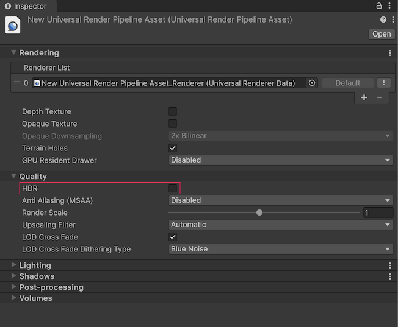
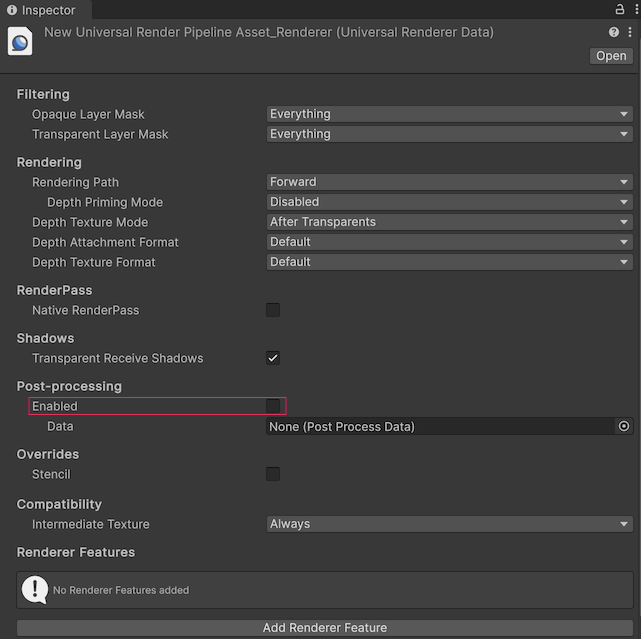

# Optimize graphics settings

Configure graphics settings in Unity for your Android XR project.

> [!TIP]
> For general recommendations on how to optimize graphics in your XR project, refer to [Optimization techniques for untethered XR devices](xref:urp-xr-untethered-device-optimization) (Unity User Manual).

[!IMPORTANT]
> In Unity 6.5 and newer, the Built-In Render Pipeline is deprecated and will be made obsolete in a future release. For more information, refer to [Migrating from the Built-In Render Pipeline to URP](https://docs.unity3d.com/6000.5/Documentation/Manual/urp/upgrading-from-birp.html) and [Render pipeline feature comparison](https://docs.unity3d.com/6000.5/Documentation/Manual/render-pipelines-feature-comparison.html).

## Enable the Vulkan Graphics API

Vulkan is the recommended graphics API for Android XR, as newer graphics features are only supported with that API.

To change your project's Graphics API to Vulkan, follow these steps:

1. Go to **Edit** > **Project Settings** > **Player**.
2. Select the Android tab and open **Other Settings**.
3. In the **Rendering** section, disable **Auto Graphics API** (if it's enabled) to reveal the **Graphics APIs** section.
4. Under **Graphics APIs**, click the **Add** button (**+**) to add a new Graphics API.
5. Select **Vulkan**.
6. Re-order the Graphics APIs using the handles (**=**) to position **Vulkan** first in the list.
7. Optionally, select any other Graphics APIs and click the **Remove** button (**-**) to remove them.

Now that you have configured Vulkan as the primary graphics API for your Android XR project, you can move on to optimizing your render pipeline.

## Configure the Universal Render Pipeline

Android XR is compatible with the Universal Render Pipeline (URP), but the default URP settings aren't optimized for best passthrough performance on Android XR.

If you created your project from a template, Unity provides multiple URP Assets for different [Quality Levels](xref:um-class-quality-settings). If you created your project from scratch, configure URP as your active render pipeline, and create the necessary URP Asset(s) as outlined in [Install URP into an existing project](xref:urp-install-urp-into-a-project).

Assign a URP asset for each active quality level for the Android platform as described in [Set URP as the active render pipeline](xref:urp-install-urp-into-a-project#set-urp-active). You can find which quality levels are active for Android in the [Quality Levels](xref:um-class-quality-settings) matrix (**Edit** > **Project Settings** > **Quality** > **Levels**).

When you configure the following settings, ensure you select the URP asset you assigned as the **Render Pipeline Asset** for the active quality level(s).

> [!NOTE]
> If your project has multiple Android XR [Quality Levels](xref:um-class-quality-settings) (**Edit** > **Project Settings** > **Quality** > **Levels**), assign a URP Asset to each quality level. The **Render Pipeline Asset** you select for each quality level overrides the asset you select in the **Graphics** settings (**Edit** > **Project Settings** > **Graphics** tab). If you assign a different URP asset to different quality levels, configure the following settings for each URP Asset.

### Optimize Universal Render Pipeline settings

Refer to this table for a list of Unity's recommended settings, and following sections for more details.

| Setting                  | Location                                          | Recommended value |
| :----------------------- | :------------------------------------------------ | :---------------: |
| **HDR**                  | Universal Render Pipeline Asset                   |      Disabled     |
| **Post-processing**      | Universal Renderer Data                           |      Disabled     |

Refer to the following sections for specific instructions on how to [configure your Universal Render Pipeline Asset](xref:androidxr-openxr-graphics-settings#configure-the-universal-render-pipeline-asset) and [configure your Universal Renderer Data](xref:androidxr-openxr-graphics-settings#configure-universal-renderer-data-settings).

> [!NOTE]
> Enable **HDR** if you're using [HDR light estimation](xref:androidxr-openxr-camera) in your project, but note that doing so can affect the performance of your application.

### Configure the Universal Render Pipeline Asset

To optimize your Universal Render Pipeline Asset for Android XR:

1. Locate the Universal Render Pipeline Asset you assigned as the **Render Pipeline Asset**. One way to do this is to search for the specific asset type by inputting `t:UniversalRenderPipelineAsset` into the **Project** window's search bar.
2. In the **Inspector**, under the **Quality** header, disable **HDR** for each URP Asset assigned to an Android quality level.

 *Universal Render Pipeline Asset shown with recommended settings.*

After you disable **HDR**, your project reduces memory bandwidth usage, improving passthrough performance on Android XR devices.

### Configure Universal Renderer Data settings

To optimize your Universal Renderer Data for Android XR:

1. Locate your project's Universal Renderer Data Asset. One way to do this is to search for the specific asset type by inputting `t:UniversalRendererData` into the **Project** window's search bar.
2. In the **Inspector**, under the **Post-processing** header, deselect **Enabled** for each Universal Renderer Data asset assigned to an Android quality level.

 *Universal Renderer Data shown with recommended settings.*

After you disable post-processing, your application achieves improved frame rates and performance on Android XR devices.

## Additional resources

* [Optimization techniques for untethered XR devices](xref:urp-xr-untethered-device-optimization)
* [Searching in the Unity Editor](xref:um-editor-searching)
* [Permissions for Android XR](xref:androidxr-openxr-permissions)
