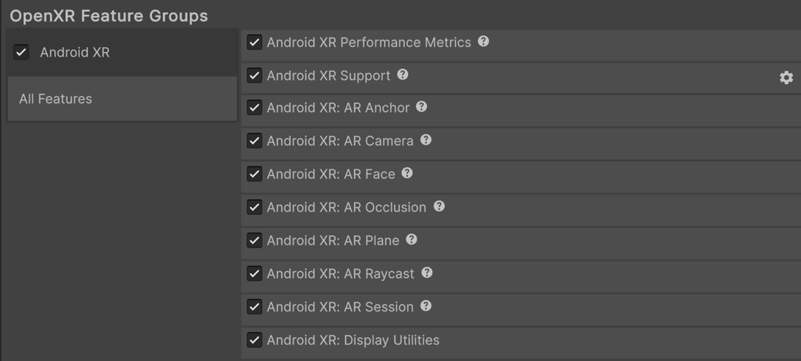
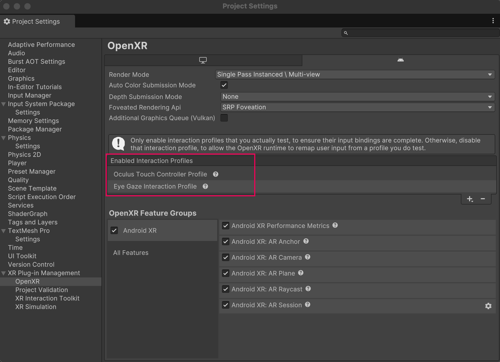

# Configure project settings

Configure your Unity project to support Android XR devices and enable immersive experiences.

Once you have [installed Android XR](xref:androidxr-openxr-installation), use the **Project Settings** window to enable Android XR features and configure interaction profiles. This ensures your application runs correctly on Android XR headsets and provides users with proper controller input, eye tracking, and AR capabilities.

Configuring these settings is essential for developers building XR applications that target Android devices, whether you're creating immersive games, productivity tools, or mixed reality experiences.

## Prerequisites

You must have the Android module installed in the version of the Unity Editor you're using. Refer to [Add modules](https://docs.unity3d.com/hub/manual/AddModules.html) for more information.

## Set up Android XR build platform and build profile

In Unity 6.1 and newer, use the Android XR build platform and build profile to configure your Android XR project. This ensures your project builds correctly for Android XR devices and applies the appropriate XR-specific settings.

> [!NOTE]
> Before you can set up your Android XR build profile, you need to install the Android module for your current Unity Editor version if you haven't done so already. To do so, you can either select your current Editor install in the Unity Hub then select **Manage** > **Add Modules** or go to **File** > **Build Profiles** > **Android XR** in the Unity Editor and select **Install with Unity Hub**.

With the Android module installed, follow these steps to set up an Android XR build profile:

1. In the Unity Editor, go to **File** > **Build Profiles**.
2. Select **Add Build Profile** and **Android XR** as the platform.
3. For **Android XR** in the **Platform Browser** dialog, select **Add Build Profile**.
4. Adding a new build profile doesn't automatically enable it, so select the **Android XR** build profile from the list, then select **Switch Platform**.

After you set up and select the Android XR build profile to enable it, you can build for Android XR devices with optimized settings.

> [!NOTE]
> To learn more about the Android XR build platform and build profile, refer to [Develop for Android XR](https://docs.unity3d.com/6000.3/Documentation/Manual/xr-android-xr-develop.html) workflow in the Unity User Manual.

## Enable Unity OpenXR: Android XR

To enable Unity OpenXR: Android XR in your project, follow these steps:

1. Go to **Edit** > **Project Settings** > **XR Plug-in Management**. If you don't already have it installed, click **Install XR Plug-in Management**.
2. In the Android tab, under **Plug-in Providers**, enable **OpenXR**.
3. While still in the **Project Settings** window, go to **XR Plug-in Management** > **OpenXR**.
4. Under **OpenXR Feature Groups**, enable the **Android XR** feature group.
5. When you enable the Android XR feature group, Unity automatically enables some features. To enable only the features relevant to your project, click on the **Android XR** feature group, and select the relevant features.

After you enable the Android XR feature group, you can access XR features like AR sessions and spatial interactions in your project.

> [!IMPORTANT]
> You must enable the **Android XR: Session** feature for [AR features](xref:androidxr-openxr-ar-features) in your project to work correctly.

 *The Android XR OpenXR feature group, shown with all features enabled.*

> [!NOTE]
> XR Plug-in Management supports only one enabled plug-in provider at a time per build target. If your project also targets ARCore using the [Google ARCore XR Plug-in](https://docs.unity3d.com/Packages/com.unity.xr.arcore@6.2/manual/index.html), to avoid errors disable the **Google ARCore** plug-in provider in the Android tab of **Project Settings** > **XR Plug-in Management** before you build an APK for Android XR devices. Likewise, disable **OpenXR** before you build for ARCore.

## Add interaction profiles

For Android XR projects using controller input, add the [Oculus Touch Controller Profile](xref:openxr-oculus-touch-controller-profile). If you're using [Eye tracking and foveated rendering](xref:androidxr-openxr-foveated-rendering) features in your project, add the [Eye Gaze Interaction profile](xref:openxr-eye-gaze-interaction).

To add the Oculus Touch Controller Profile and the Eye Gaze Interaction profile:

1. Go to **Edit** > **Project Settings** > **XR Plug-in Management**.
2. In the Android tab, under **Plug-in Providers**, enable **OpenXR**.
3. While still in the **Project Settings** window, go to **XR Plug-in Management** > **OpenXR**.
4. In the Android tab, under **Enabled Interaction Profiles**, add **Oculus Touch Controller Profile** and **Eye Gaze Interaction profile**.

After you add the interaction profiles, your Android XR project can support Oculus Touch controllers and eye gaze interactions. This enables users to interact with your application using hand controllers and eye tracking.

 *Enabled profiles include the Oculus Touch Controller Profile and the Eye Gaze Interaction Profile.*

## Configure additional settings

Once you have added interaction profiles, configure the following settings for Android XR.

> [!TIP]
> Access [Android Player Settings](xref:um-class-player-settings-android#Resolution) in Unity by selecting **Edit** > **Project Settings** > **Player** > **Android** tab > expand **Resolution and Presentation**.

### Enable run without focus

By default, Unity disables **Run Without Focus** when you create a project from scratch. When Unity disables it, the application pauses but remains visible.

Enable **Run Without Focus** in the **Android** > **Resolution and Presentation** > **Resolution** section of [Android Player settings](xref:um-class-player-settings-android#Resolution) to keep your application running when it's not in focus but is visible. For example, on devices supporting split-screen mode.

After you enable **Run Without Focus**, your application continues running in the background when not in focus, preventing issues with XR tracking and input systems.

> [!IMPORTANT]
> Ensure you enable this setting if your project uses the Input System [Tracked Pose Driver](xref:UnityEngine.InputSystem.XR.TrackedPoseDriver) component. Without **Run Without Focus** enabled, you can encounter headlock issues in your project.

### Enable resizeable activity for dialog windows

Most Android XR apps require the activity window to be resizable so the device can render pop-ups, such as system permission requests.

To make sure the device renders dialog windows correctly, enable **Resizeable Activity** in the **Android** > **Resolution and Presentation** > **Resolution** section of the [Android Player settings](xref:um-class-player-settings-android#Resolution).

After you enable **Resizeable Activity**, your application can display system dialog windows and permission requests on Android XR devices.

> [!NOTE]
> Earlier versions of Unity named this setting **Resizable Window.**

### Set application entry point

Android XR requires you to [Set the Application Entry Point](xref:um-android-application-entries-set) for your project to **GameActivity**.

You can set the **Application Entry Point** in the [Android Player settings](xref:um-class-player-settings-android).

After you set the **Application Entry Point** to **GameActivity**, your Android XR application uses the correct entry point for optimal performance and compatibility with XR devices.

> [!TIP]
> To learn more about Game Activity, refer to [The GameActivity application entry point](xref:um-android-application-entries-game-activity).

## Additional resources

* [Set up your scene](xref:androidxr-openxr-scene-setup) for Android XR
* [Develop for Android XR](https://docs.unity3d.com/6000.3/Documentation/Manual/xr-android-xr-develop.html) workflow
* Learn about [Android Player settings](xref:um-class-player-settings-android)
