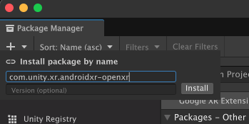

# Install Android XR for Unity

Install the Unity OpenXR: Android XR package in your Unity project via the Package Manager.

## Prerequisites

To use the Unity OpenXR: Android XR package in Unity, your project must meet the following requirements:

* Unity 6000.0.23f1 or newer (latest 6000.3 LTS version from the [Unity Editor Archives](https://unity.com/releases/editor/archive) recommended)
* [Android Build Support](xref:um-android-install-dependencies) module
* [AR Foundation](xref:arfoundation-manual) 6.2.0 or newer
* [OpenXR](xref:openxr-manual) 1.15.0 or newer
* [XR Hands](xref:xrhands-manual) 1.6.0 or newer

When you install this package, if you don't already have AR Foundation or OpenXR in your project, the Package Manager automatically installs these dependencies.

> [!NOTE]
> If you add the [Android XR build profile](xref:androidxr-openxr-project-setup#build-profile) in Unity 6.1 and newer, Unity automatically installs the latest compatible version of the Unity OpenXR: Android XR package.

## Install Unity OpenXR: Android XR

Unity OpenXR: Android XR is an official Unity package available via the [Package Manager](xref:um-upm-ui).

To install the Android XR package from the Package Manager:

1. Create a new Unity project or open an existing one.
2. Click the link: [com.unity.xr.androidxr-openxr](com.unity3d.kharma:upmpackage/com.unity.xr.androidxr-openxr).

   The **Package Manager** window opens with the package name entered in the **Install package by name** dialog.

   

   > [!NOTE]
   > If you don't specify a version, Unity installs the default version for your current Unity Editor. For bundled packages, this is the version included with the Editor.
   >
   > Refer to the [Changelog](xref:androidxr-openxr-changelog) for a full list of available versions of the Unity OpenXR: Android XR package.

3. Enter the full version number, such as <code class="long_version">X.Y.Z</code>, to install a specific version. To install the default version for your current Unity Editor, you can omit the version number. If you're using an older Unity Editor version and want the latest available package version, you must specify the version number.

4. Click **Install** to add the package to your project.

The OpenXR: Android XR package is now installed in the current Unity Editor.

## Additional resources
* [Get started with Android XR in Unity](xref:androidxr-openxr-get-started)
* [Learn about OpenXR: Android XR Architecture](xref:androidxr-openxr-architecture)
* [Install a UPM package from a registry](xref:um-upm-ui-install)
